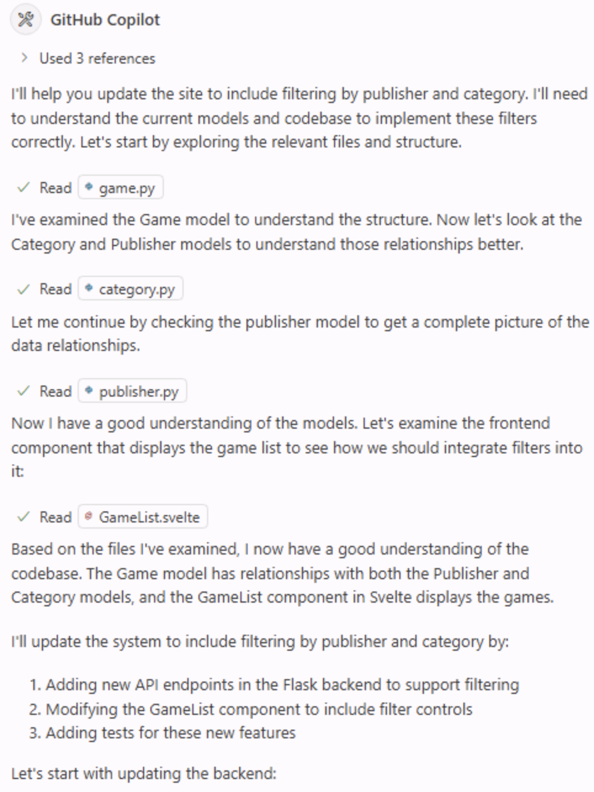

Até as atualizações mais simples de um aplicativo normalmente exigem alterações em vários arquivos e tarefas como executar testes. Em geral, a pessoa desenvolvedora localiza os arquivos necessários, faz as alterações, executa os testes, depura, percebe que faltou outro arquivo, faz mais uma alteração — e assim por diante.

É aí que entra o modo de agente do Copilot.

O modo de agente foi criado para atuar com mais autonomia no IDE. Ele funciona de maneira semelhante a uma pessoa desenvolvedora: começa explorando a estrutura do projeto, faz as alterações necessárias, executa tarefas como testes e corrige automaticamente os problemas encontrados. Vamos ver como usá-lo para adicionar funcionalidades ao site.

> [!NOTE]
> Apesar dos nomes parecidos, o modo de agente e o agente de nuvem oferecem experiências diferentes. O modo de agente executa tarefas no IDE, permitindo ciclos rápidos de feedback e interação. O agente de nuvem trabalha de forma assíncrona como uma pessoa da equipe e interage com você por meio de issues e pull requests.

Neste exercício, você vai aprender como:

- o modo de agente do Copilot explora o projeto, identifica os arquivos relevantes e coordena as alterações.
- o modo de agente do GitHub Copilot implementa recursos na interface e na camada de dados.
- revisar alterações e testes gerados pelo modo de agente antes de integrá-los à base de código.

## Cenário

À medida que a lista de jogos cresce, você quer permitir que as pessoas filtrem por categoria e editora. No exercício anterior, você adicionou um helper de editoras. Agora, vai concluir o trabalho restante na camada de dados, na interface e nos testes usando o modo de agente do Copilot.

## Execute o site Tailspin Toys

Antes de fazer alterações, vamos explorar o site Tailspin Toys para entender seus recursos atuais.

O site é uma plataforma de financiamento coletivo de jogos de tabuleiro com tema de desenvolvimento. Ele permite listar jogos e exibir detalhes. É um único aplicativo Astro, que gera páginas como HTML estático durante o build. As páginas consultam diretamente um banco de dados SQLite local no frontmatter, usando o Drizzle ORM. Não há API de back-end separada nem framework de interface no lado do cliente. Os helpers reutilizáveis de acesso a dados ficam em `src/lib/`, e a interatividade usa pequenos elementos Astro `<script>` com as APIs padrão do DOM.

### Inicie o site

O projeto oferece a tarefa `npm run dev`, que inicia o único servidor de desenvolvimento Astro. Para executá-la no GitHub Codespace:

1. Volte ao Codespace. Depois do exercício anterior, você deverá estar em `main`.
2. Abra um novo terminal no Codespace pressionando <kbd>Control</kbd>+<kbd>\`</kbd> (Mac) ou <kbd>Ctrl</kbd>+<kbd>\`</kbd> (Windows/Linux).
3. Atualize `main` e crie uma branch para o trabalho de filtragem:

   ```bash
   git checkout main
   git pull
   git checkout -b filtering-vscode
   ```

4. Inicie o site:

   ```bash
   npm run dev
   ```

   Quando o servidor Astro estiver pronto, você verá uma mensagem com a URL, semelhante a:

   ```bash
   🚀 Tailspin Toys is ready!
      Astro server: http://localhost:4321
      Press Ctrl-C to stop.
   ```

> [!NOTE]
> Se uma caixa de diálogo pedir para abrir um navegador em `http://localhost:4321`, feche-a selecionando **x**.

5. Abra o site mantendo <kbd>Command</kbd> pressionado (Mac) ou <kbd>Ctrl</kbd> (Windows/Linux) e selecionando o endereço do servidor Astro `http://localhost:4321` no terminal.

> [!NOTE]
> Em um Codespace, selecionar o link local no terminal redireciona automaticamente para `https://<your-codespace-name>-4321.app.github.dev/`. Esse é um túnel privado para o Codespace, que agora hospeda o servidor web.

### Explore o site

Com o site em execução, explore suas funcionalidades:

- **Página inicial**: mostra uma lista de jogos de tabuleiro com títulos, imagens e descrições.
- **Página de detalhes do jogo**: ao selecionar um jogo, você verá uma página com mais informações, como título, descrição, editora e categoria.

## Explore o backlog com o Copilot

> [!TIP]
> **Abra o Copilot Chat**
>
> Antes de começar os exercícios abaixo, volte ao Codespace, abra o painel Copilot Chat e selecione **New Chat** para iniciar uma conversa limpa. O modo e o modelo variam conforme o exercício; as etapas indicarão as opções relevantes.

O site já funciona, mas queremos adicionar recursos. Vamos começar examinando o backlog. Ao configurar o projeto a partir do template, um backlog de issues foi criado automaticamente. Peça ao GitHub Copilot que mostre esses itens.

1. Na lista de agentes da visualização Chat, selecione **Agent**. O agente planeja e implementa alterações em vários arquivos, executa comandos no terminal e usa ferramentas.

   

2. Na lista de modelos disponíveis, selecione **Claude Sonnet 4.5**.

> [!CAUTION]
> As pessoas autoras deste workshop não estão recomendando um modelo específico. Usamos Claude Sonnet 4.5 ao desenvolver o workshop e o incluímos para tentar manter as sugestões relativamente consistentes. Como os LLMs são probabilísticos, é normal que as sugestões variem.

> [!NOTE]
> Devido à natureza probabilística dos LLMs, o Copilot pode usar um comando MCP diferente, mas ainda deverá concluir a tarefa.

3. Envie este prompt ao Copilot para consultar o backlog de issues:

   ```plaintext
   Please show me the backlog of items from my GitHub repository. Help me prioritize them based on those which will be most useful to the user.
   ```

4. Selecione **Continue** para executar o comando que lista as issues.
5. Revise a lista gerada.

Observe que o Copilot também priorizou os itens conforme a utilidade que acredita terem para os usuários.

## Revise os arquivos de instruções

Antes de pedir ao agente para gerar código, leia o arquivo de instruções que fornecerá contexto. Vamos usar o arquivo de [interface do usuário (UI)](https://github.com/github-samples/tailspin-toys/blob/main/.github/instructions/ui.instructions.md), que explica como abordar a adição de funcionalidades ao site.

1. No Codespace, abra `.github/instructions/ui.instructions.md`.
2. Observe as orientações gerais para adicionar funcionalidades, incluindo:
   - uma visão geral da arquitetura.
   - princípios de design de componentes, testabilidade e acessibilidade.
   - links para instruções de tipos de arquivo, incluindo Astro, Tailwind CSS e Drizzle.

> [!TIP]
> Os arquivos de instruções podem fazer referência a outros arquivos de instruções e arquivos do projeto. Os caminhos são relativos ao arquivo de instruções. Isso facilita a reutilização, a divisão de instruções complexas em partes menores e a inclusão de exemplos e modelos.

## Implemente a filtragem

Para concluir a filtragem, serão necessárias pelo menos três alterações:

- adicionar ou aprimorar a lógica de filtragem restante na camada de dados (`src/lib/`).
- adicionar ou atualizar testes do comportamento de filtragem.
- atualizar a página de listagem de jogos para incluir a interface de filtragem.

Além disso, os testes precisam ser executados e aprovados antes do merge. O modo de agente do Copilot pode executar essas tarefas. Vamos adicionar a funcionalidade.

1. Continue a conversa atual com o Copilot ou selecione **New Chat** para iniciar outra.
2. Selecione **Add Context**, **Instructions** e **ui** como arquivo de instruções.

   

3. Confirme que **Agent** continua selecionado na lista de agentes da visualização Chat.

   

4. Confirme que **Claude Sonnet 4.5** continua selecionado como modelo.
5. Peça ao Copilot para implementar a funcionalidade conforme a issue relacionada no backlog:

   ```plaintext
   Please update the site to include filtering by publisher and category based on the requirements from the related GitHub issue in the backlog. A publishers helper already exists from the previous exercise, so preserve and refine that work as needed while completing the remaining data-layer, UI, and tests. Ensure all tests are passing before completion. The server is already running, so you do not need to start it up.
   ```

6. Observe o Copilot explorar o projeto e localizar os arquivos relevantes para a funcionalidade, incluindo os helpers da camada de dados, a interface e os testes. Em seguida, ele alterará os arquivos e executará os testes.

   

> [!NOTE]
> O Copilot executará várias tarefas, como explorar o projeto, alterar arquivos e rodar testes. Isso pode levar alguns minutos, dependendo da complexidade da tarefa e da base de código. Durante o processo, os botões **Keep** e **Undo** podem aparecer no editor. Quando o Copilot terminar, haverá uma opção **Keep** ou **Undo** para cada alteração; não é necessário selecioná-las enquanto o trabalho está em andamento.

7. Quando solicitado pelo Copilot, selecione **Continue** para executar os testes.

   

8. Pode haver pausas e falhas em alguns testes durante o processo. Isso é normal: o Copilot alterna entre gerar código e executar testes até concluir a tarefa e não detectar erros.

   

9. Examine o código gerado para identificar possíveis problemas.

> [!CAUTION]
> É sempre importante revisar o código gerado pelo Copilot ou por qualquer outra ferramenta de IA.

10. Volte ao navegador com o site em execução e explore a nova funcionalidade.
11. Depois de confirmar que tudo funciona e revisar o código, selecione **Keep** na janela Copilot Chat.

## Resumo e próximos passos

Parabéns! Neste exercício, aprendemos a usar o modo de agente do GitHub Copilot para adicionar recursos ao site Tailspin Toys. Você viu como:

- o modo de agente do GitHub Copilot implementa funcionalidades na interface e na camada de dados.
- o modo de agente explora o projeto, identifica arquivos relevantes e coordena alterações.
- revisar as alterações e os testes gerados pelo modo de agente antes do merge.

Agora vamos [testar o recurso com o servidor MCP do Playwright][next-lesson] e abrir um pull request.

### Exercício extra de exploração — implementar paginação

À medida que a lista de jogos cresce, será necessário oferecer paginação. Use as habilidades deste exercício para pedir ao Copilot que implemente a paginação. Considere:

- seguir as práticas recomendadas existentes, incluindo o uso dos arquivos de instruções.
- decidir como a paginação deve funcionar, por exemplo, se as pessoas poderão escolher o tamanho da página ou se ele será fixo.
- fornecer ao Copilot as orientações necessárias para implementar o comportamento desejado.
- iterar com o GitHub Copilot, solicitando alterações e oferecendo contexto. Esse é o fluxo normal de trabalho com o Copilot.

## Recursos

- [Modos ask, edit e agent do Copilot: o que fazem e quando usar][choose-mode]
- [Modo de agente no VS Code][vs-code-agent-mode]

[previous-lesson]: ../1-custom-instructions/
[next-lesson]: ../3-mcp/
[choose-mode]: https://github.blog/ai-and-ml/github-copilot/copilot-ask-edit-and-agent-modes-what-they-do-and-when-to-use-them/
[vs-code-agent-mode]: https://code.visualstudio.com/docs/copilot/chat/chat-agent-mode
